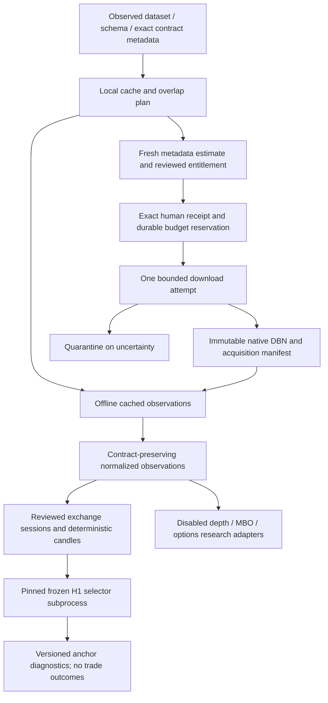

# Databento CME research foundation

This is an opt-in, local research package. It is not registered with production,
does not change the frozen H1 selector, and does not publish signals or place
orders. The existing FlashAlpha/ThetaData/Unusual Whales provider hierarchy is
unchanged. No new provider usage, credit consumption or deployment occurred.

## Architecture and reused components



The implementation reuses the existing GCReplay quarantine/volume conventions,
Gold basis and options normalizers, canonical hierarchy/structure/Fibonacci
engines, and PostgreSQL document CAS interface. It brings the previously isolated
Databento research foundations into this checkout and extends their controls.
`docs/audits/databento-reused-sources.json` records each original source hash.
The only shared analytical-file changes are optional identity-policy arguments
in GC/OG normalizers and explicit research namespaces. Legacy defaults remain
unchanged. No hierarchy, Fibonacci, risk, approval, deployment, MT5 or Telegram
production-policy files were edited.

## Dataset, schemas and instruments

Dataset means feed origin, schema means native record granularity, and raw symbol
means an exact contract. `datasets.py` records observed schema availability and
metadata hashes. Availability does not establish account entitlement. Refresh
observations through official metadata methods for a future authorized request.

| Dataset / schema | Local capability | Acquisition capability | Evidence |
|---|---|---|---|
| GLBX.MDP3 / definition | GC/standard OG registry; GC/OG/ES/NQ/CL discovery | Explicit contracts only, bounded requests | Actual GCZ6 definitions verified; other discovery uses SDK-shaped fixtures |
| GLBX.MDP3 / ohlcv-1m | Native normalization, H1/H4/M15/M5 aggregation | Guarded and default zero budget | Existing authorized GCZ6 history |
| GLBX.MDP3 / ohlcv-1h | Native normalization; contract/session/finalization checks | Guarded and default zero budget | SDK-shaped fixtures; no new H1 acquisition |
| GLBX.MDP3 / trades | Executed sizes/prices; side evidence; bounded profile/POC/CVD | Guarded and default zero budget | Existing GC trades; unknown aggressor stays null |
| GLBX.MDP3 / mbp-1 | Quote normalization/spreads; visible quantity | Guarded and default zero budget | Existing GC quotes and offline fixtures |
| GLBX.MDP3 / mbp-10 | Ten-level normalization, imbalance/concentration and net visible changes | Download disabled | SDK-shaped fixtures only; explicit adapter opt-in |
| GLBX.MDP3 / mbo | Order IDs/actions/clock provenance; informational fills distinct | Download disabled | Default disabled; explicit research question required |
| GLBX.MDP3 / statistics | Published statistics/OI observations | Guarded and default zero budget | Existing GC statistics interface; options OI fixtures |
| GLBX.MDP3 / status | Categorical exchange status | Guarded and default zero budget | Existing GC archive; not a continuity certificate |
| XNAS.ITCH, XNYS.PILLAR, OPRA.PILLAR, XCBF.PITCH, XEUR.EOBI, IFUS.IMPACT | Extension identifiers only | Unimplemented | No assumed schema compatibility or entitlement |

Parent hints `GC.FUT`, `OG.OPT`, `ES.FUT`, `NQ.FUT`, `CL.FUT` support discovery;
acquisition rejects parent/continuous/ALL_SYMBOLS requests. Reviewed raw-symbol
mappings must cover the whole exact date range. Other CME products require their
own convention review before admission. Automatic most-active rollover is not
implemented. `RollSelection` records an explicit reviewed switch; aggregation
rejects mixed identities and never back-adjusts prices.

## Provenance and storage

Raw DBN/ZSTD stays unchanged in the operator-selected filesystem archive. Source
bytes, native timestamps and record hashes remain authoritative. Each replay
retains dataset/schema, publisher/instrument IDs, raw contract, definitions and
catalog hashes, retrieval/admission clocks, record ordinal and flags. Native
nanoseconds are not replaced by datetime presentations. Original availability
is never renewed by rereading a record.

`LocalHistoricalMetadata` supplies persistent SQLite CAS manifests for standalone
research; `HistoricalMetadata` retains the existing PostgreSQL implementation.
`ResearchArtifactStore` publishes hash-addressed normalized observations, candles,
indicators, quality reports, replays, metadata and costs using fsync and exclusive
hard-link publication. Licensed source/replay data belong under ignored
`research-data/` or `private-reports/`, never in public Git history. Application
immutability does not replace backups or owner-controlled WORM storage.

Exchange calendars require bounded, source/version/hash-labelled UTC intervals
from a reviewed CME calendar. Broker XAUUSD sessions are a different calendar.
UTC aggregation rejects partial session buckets, missing children, duplicate or
revised candles and mixed contracts. OHLCV minutes without records can mean no
trades; quality reports retain that uncertainty and never fabricate zero-volume
or carried-forward bars. Close plus ten seconds is an explicit retrospective
research assumption, not proof of historical local receipt. Transport completion
and exchange continuity are separate; imported replay attestations are trusted
reviewed-source boundaries, not automatic certification.

GC remains GC. Genuine synchronized broker observations and a separately
validated mapping are needed for contextual basis conversion. The existing
`GoldBasisService` remains contextual and cannot provide an executable price.

## Cost controls and authorization

The default research budget is **$0**. All acquisition paths inspect local
artifacts first. A covering file or a complete union of partitions produces a
zero-increment cache plan. Overlap detection includes successful, pending and
failed attempts; unresolved ranges cannot be silently purchased again. A caller
must explicitly slice cached data or review exact genuinely uncovered scopes.

For a new request, record dataset/schema, exact contracts and inclusive/exclusive
UTC range; obtain `SDKHistoricalSource.preflight()` with schema-specific availability,
publisher/symbology proof and `metadata.get_cost`. A failed estimate blocks download.
Review license/entitlement separately. Configure a shared ledger budget with an
opaque approval reference, then supply an `ApprovedDownload` binding exact request
and preflight hashes, short expiry and upper estimate. Python receipt objects are
trusted operator inputs; they do not authenticate a human or grant a license.
The implementation does not manufacture or renew them.

`ResearchLedger` atomically reserves approved estimates across processes. The
lowest SDK billable boundary consumes a one-use persistent budget permit. Available
signup credit never bypasses the budget/approval gate. Credit balance, actual API
usage and settled cash charges are reported separately. Estimates are not provider
charge caps; errors or local caps can occur after provider usage. Unknown billing
retains the reservation. Billing can exceed an estimate; settlement records actual
usage and future requests fail if the budget is exhausted.

Incomplete downloads retain native partial files and quarantined manifests.
There is no automatic chargeable retry. An explicit retry requires a new receipt,
fresh preflight, reviewed stopped/settled prior attempt, prior billing settlement
in the ledger and a remaining budget. Historical cache registration verifies
native bytes/request coverage without new charges and retains unknown old billing
as unknown. Cache indexing does not authorize acquisition or certify continuity.

## Advanced and options research

`AdvancedAdapters` has no enabled schemas by default and no network interface.
Trades, MBP-1 and MBP-10 can be explicitly enabled for offline observations. Quote
messages with trade/fill actions do not contribute executed volume. Imbalance is
`(visible bid size - visible ask size) / (bid size + ask size)` for two-sided books;
concentration is largest visible level size divided by total visible side size.
Output binds the source record, contract and formula version. Snapshot changes
are net visible quantities with unknown cause; sampling boundaries, hidden liquidity,
cancellations and executions prevent causal or institutional-intent claims.

MBO requires an explicit research-question reference and remains event-only.
Native A/M/C/R/T/F/N semantics, order IDs and clocks are retained. Informational
fills are not counted again. Queue priority, lifecycle reconstruction, snapshot
recovery, implied-order behavior and continuity need separate certification before
queue analytics. MBO and MBP-10 history acquisition remains rejected.

`options.py` joins a reviewed standard OG definition to its exact underlying GC
quote, separate local availability, synchronized native quote clocks and optional
published OI. OI reference/publication times are distinct; unavailable OI remains
null. Existing American CRR/IV routines and European benchmark Greeks are reused,
but this input pipeline emits no Greeks/GEX/gamma flip/dealer inventory. Actual
OG native conventions, complete chains, OI publication calendars, rates and stable
American Greeks remain external dependencies. ThetaData/Unusual Whales GC coverage
is unverified. No GIL is enabled in GC Fibonacci research.

## Reproducible local commands

Install the repository's locked extras:

```sh
uv sync --frozen --extra dev --extra gold-data
```

Run credential-free offline acceptance, using existing local PostgreSQL/Redis
binaries in temporary isolated instances; all services stop at the end:

```sh
.venv/bin/python scripts/test_cme_offline.py \
  --output private-reports/full-tests-NEW \
  --h1-checkout /path/to/unchanged/monatise-gold-h1-fib-f0
```

Reverify previously acquired authorized GC artifacts and replay twice:

```sh
.venv/bin/python -m monatise.research.databento.verify_existing \
  --data-root /path/to/monatise-gc-research-2026-10-11 \
  --h1-checkout /path/to/unchanged/monatise-gold-h1-fib-f0 \
  --output private-reports/gc-verification-NEW
```

The source checkout must remain clean and pinned at
`f1de9d46cb5f3458726b81cfbc9f1d0dfba73f35`; it is an explicit dependency, not a
silently replaced selector. Verification rejects source overrides, conflicting
outputs, changed native prices and nondeterministic results. Frozen source/raw
licensed archives are not copied into this repository. Missing optional SDK or
source checkout causes explicit test skips, not fabricated market evidence.

Official references: [historical API/cost estimation](https://databento.com/docs/reference-historical/basics/),
[schemas](https://databento.com/docs/schemas-and-data-formats),
[GLBX.MDP3](https://databento.com/docs/venues-and-datasets/glbx-mdp3),
[order tracking](https://databento.com/docs/examples/order-book/order-tracking).
