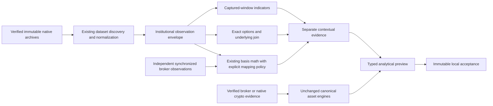

# Multi-asset institutional data architecture

Phase 4 remains an opt-in offline research layer. The audited dependency matrix is
in [the integration audit](audits/monatise-phase4-integration-audit.md).

Institutional context is attached with source identities and limitations; it does
not add votes, bypass gamma validation or substitute futures prices into broker
candles/entries/stops. Every preview hard-codes execution/publication/approval/GIL
disabled. No live subscription, runtime route, trade command or external notification
is created. Authenticated acquisition stays in the existing guarded infrastructure.

## Data and indicator contracts

Each envelope binds provider/dataset/schema, publisher/economic exchange, exact raw
contract/ID/expiry, asset class/currency/tick/multiplier, event/receive/admission clocks,
record/archive/definition hashes, native source ordinal, evidence kind and normalization
version. Schemas without receive timestamps retain null rather than inventing one.
Historical retrieval/admission is not falsely represented as contemporaneous availability.
Missing session, correction or continuity certification is explicit.

GC/ES/NQ/OG are priority identities; CL can use existing reviewed discovery. Secondary
products are disabled descriptors, not fabricated definitions or subscriptions.
Definitions/OHLCV/trades/MBP-1/status/statistics use existing normalizers where compatible.
MBP-10/MBO retain existing explicit opt-in controls and are not acquired in Phase 4.

Indicators bind a defined interval/session, exact source positions and formula version.
VWAP is sum(price × executed quantity)/sum(quantity); profiles use exact native tick
prices, with lowest-price deterministic ties for POC. Known-side delta counts only
published buy/sell aggressors; unknown quantity is reported and full CVD is unavailable
when direction is incomplete. Snapshot spread/imbalance/concentration reuse visible
book metrics and never claim executed volume or institutional intent. Price-return
volatility is labelled by interval/sample methodology without an annualization guess.
Published OI changes retain reference/publication/availability clocks and revisions.
Captured-data indicators never certify missing exchange activity by themselves.

## Mapping and asset decisions

The general context mapper reuses GoldBasisService's synchronized midpoint, median,
dispersion, residual, freshness and roll-reset calculations. Non-Gold thresholds
require an explicit reviewed mapping policy. A common quote/session/identity boundary
adds native nanosecond checks, currency/units, source provenance and expiry. Mapped
levels are contextual estimates with sampling and spread uncertainty. Lack of genuine
synchronized broker observations returns MAPPING_UNAVAILABLE with no assumed offset.

Gold uses GoldHierarchyAnalysis/GoldAnalysisCoordinator on XAU/USD broker inputs;
indices use AssetHierarchyAnalysis plus the existing FlashAlpha context validation;
crypto uses build_production_analysis_run and canonical analytical engine registrations
on native crypto inputs. Gold's GC historical selector is not used to create broker
signals. Fixture transports and clocks are engineering tests, labelled in every output.
Unavailable canonical inputs produce explicit rejection. Preview schema distinguishes
LONG, SHORT, NO_TRADE, INSUFFICIENT_MARKET_DATA and MAPPING_UNAVAILABLE; its proposed
geometry is never execution authority.

## Options and models

Use exact option/underlying definitions, reviewed exercise family, synchronized
option/underlying quotes, published OI and an explicit dated rate assumption. Reuse
the existing futures CRR American pricing/IV and European Black-76/Greeks. American
gamma remains unavailable without independent stability validation. European Greeks
are model estimates for a verified European convention, not exchange-published facts.
Unsigned gamma × OI × multiplier × futures-price² × 0.01 is a declared sensitivity
measure per 1% move, never signed dealer GEX. Group by strike/expiry only over the
supplied scope. No dealer sign, gamma flip or complete-chain claim is inferred from OI.
Preserve the current GIL provider hierarchy and keep GIL disabled.

## Isolation, reproducibility and acquisition

The credential-free runner uses Python -I, an allowlisted environment and guarded
native input/output paths. It denies network/process creation, secret file reads and
execution/publisher module imports. This is defense in depth for trusted source, not
an OS sandbox for hostile arbitrary code. Canonical services are created with no broker
master, external providers or durable publication repository. Fixed clocks, sorted
serialization, immutable artifact publication and before/after source hashes bind
repeated outputs. Raw licensed data stays outside Git.

Requests for unavailable ES/NQ exact definitions and minimal sample observations are
proposals only. Parent/root discovery never becomes an exact tradable contract. After
definitions are observed, create exact-ID scope with the existing cache overlap planner,
current provider estimate, fresh credit/licensing review and separately confirmed
numeric credit-only ceiling/request-specific receipt. No cash, automatic retries or
default-budget changes are permitted. No raw prices are published to third parties.

Live readiness requires measured replay-to-stream parity, channel-aware continuity,
snapshot recovery, reconnect backoff and quarantine, heartbeat/age checks, session/roll
lifecycle, bounded queues and durable provenance under overload/outage. Existing
PostgreSQL/Redis runtime and immutable local research files are sufficient for now;
QuestDB/Grafana/Kafka have no demonstrated requirement.
