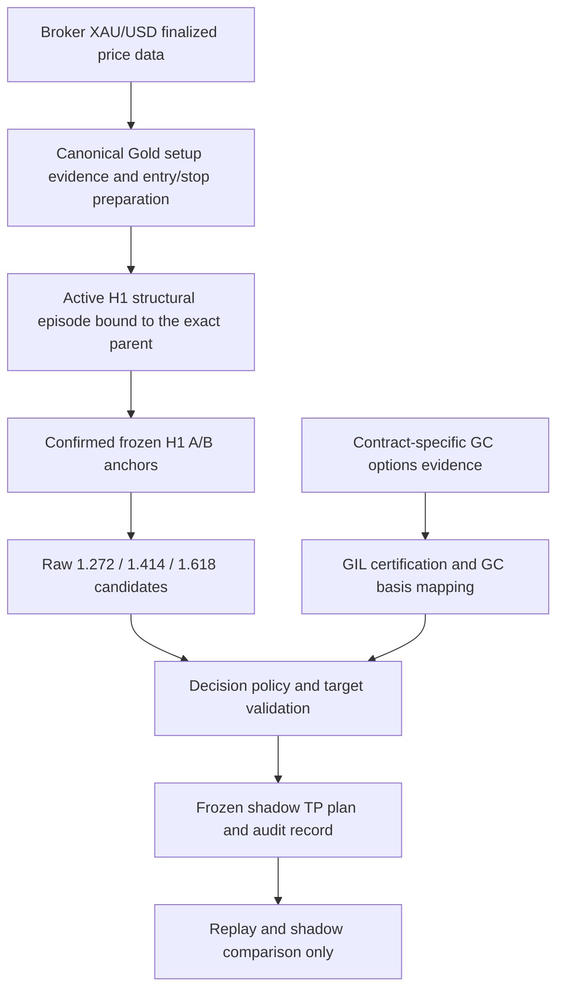

# Draft Monatise Gold Fibonacci Take Profit Implementation Specification

**Status:** H1 anchor revision ready for review, revision 2 dated 10 October 2026, Africa/Lagos. This specification uses gold-fib-h1-structural-leg-v1. Option 3 has not started; implementation, deployment and live policy activation are not authorized by this revision.

Monatise will derive Gold Fibonacci candidates from a confirmed H1 structural leg associated with the H1 directional parent of the qualified M15/M5 setup on the intended broker XAU/USD instrument. The existing Fibonacci Liquidity Engine will validate a constrained anchor pair and calculate 1.272, 1.414 and 1.618 extensions. GIL will remain a separate source of certified options positioning and mapped conflict or confluence evidence. A candidate extension, a resolved exit and an observed market price are separate facts.

The first implementation will be an isolated shadow evaluator and replay runner. It will have no publishing transport, approval service, command producer, deployment integration or live-order capability. All ten requested topics are specified below; the final section defines the proposed Option 3 work.

## Source baseline and existing behavior

The source of truth is [Patrick8552/monatise-live at 0f12862b8d11f6559bc77a5df1dd2a6dbd6c1b18](https://github.com/Patrick8552/monatise-live/tree/0f12862b8d11f6559bc77a5df1dd2a6dbd6c1b18), verified against GitHub main for this specification. The actual currently deployed commit, settings and provider entitlements are not established by a source review.

| State | Verified behavior | Boundary |
|---|---|---|
| Historical production-capable source at 9f396bf | GC=F FlashAlpha snapshots produced flip/wall geometry and RR-qualified Gold watch signals; broker validation and durable Telegram proposals followed. Gold did not call the candle/Fib hierarchy. | This is the archived source route, not a claim about which release ran on a particular trading date. |
| Current main Gold route | Exact registered XAU/USD enters GoldAnalysisCoordinator and GoldHierarchyAnalysis. Broker candles establish technical structure. Canonical engines and the multi-target adapter are reused. | Gold analytical publication, approval, pending eligibility and execution are disabled. There is no live activation knob for this new route. |
| Current target selection | crypto_layer_candidates collects liquidity, swing, zone and confluence-backed Fib levels. HierarchyLayerEvaluator collects candidates across available timeframes. build_plan retains the nearest acceptable candidate and ranks additional candidates. | Generic anchor scoring and mixed target selection do not implement one setup-associated three-ratio ladder. |
| Proposed behavior | The active H1 structural episode associated with the exact Gold H1 parent constrains one confirmed pair. Raw ratio slots are fixed; a separately selected policy resolves final targets. | Research output remains distinct from current canonical output and cannot become an executable proof. |

Current Gold technical requirements remain H4 advisory context, H1 directional structure, M15 causal sweep/rejection/displacement/shift/retest, a later aligned recent M5 trigger and M1 entry refinement. The proposed policy additionally uses H1 for Fib anchoring while retaining M15/M5/M1 for setup/trigger/entry. Stops retain the M15 sweep invalidation plus the existing volatility, spread, slippage and broker-unit buffers. Fib and GIL do not add a fourth mandatory evidence vote.

The shared TimeframePolicy currently sets context lifetime 5 hours, H1 lifetime 2 hours, setup lifetime 45 minutes, confirmation lifetime 15 minutes and signal lifetime 15 minutes. Gold further caps contexts by original candle close and parent expiry. These source-defined lifetimes, including session closure, must be reused rather than replaced with a blanket 30-minute expiry. Re-reading evidence must not renew it. [Gold policy and chronology](https://github.com/Patrick8552/monatise-live/blob/0f12862b8d11f6559bc77a5df1dd2a6dbd6c1b18/monatise/application/gold_analysis.py#L19), [shared timeframe policy](https://github.com/Patrick8552/monatise-live/blob/0f12862b8d11f6559bc77a5df1dd2a6dbd6c1b18/monatise/application/hierarchy/policy.py#L15).

## Architecture and qualification order

Data Layer owns instrument identities, normalization, timestamps, finalized candles, coverage, sessions and raw evidence. Analysis Layer owns separate H1 structural episode and M15 setup extraction, H1 anchor validation, Fib computation, GIL computation and contextual basis mapping. Decision Layer owns candidate acceptance, conflict policy, final exit ordering, allocation and RR. A future separately approved execution layer would revalidate the unchanged plan against real broker quotes and existing account controls.

Here, Decision Layer names a responsibility boundary. The current Gold hierarchy does not call the generic engines/decision/DecisionEngine to produce these targets. Its canonical qualification is assembled by GoldHierarchyAnalysis and the hierarchy evidence/target validators. The proposed Gold target-policy evaluator must complete that existing Gold contract; substituting generic DecisionEngine scoring would change the strategy. Historical FlashAlpha Gold walls and unimplemented GIL illustrations likewise cannot establish the new anchors.

There is a qualification dependency to address explicitly. Current Gold analytical qualification already includes target-plan and RR validation. Using only current qualified results as the new evaluator's input would discard technical episodes rejected by the old target selection and bias comparisons. Introduce a typed **GoldSetupSeed** before target validation: it must pass every target-independent canonical requirement, retain authentic entry/stop inputs and remain nonqualified/nonexecutable. Each target variant then finishes its own target and RR validation. Preserve the original canonical result as a parallel baseline; never overwrite its decision with a research result.

The seed is not a fabricated EvidenceBundle with placeholder targets or fake passing RR. Extract the existing context-chain, session, chronology and entry/stop validations into reusable stages. Existing default callers must still execute all stages with unchanged behavior. A variant becomes research-qualified only after the existing final RR and target checks succeed.

## 1 H1 structural leg anchor selection

### H1 anchor policy and hierarchy

The anchor policy is **gold-fib-h1-structural-leg-v1**. Anchor timeframe resolves through SHARED_TIMEFRAME_POLICY.analysis, currently H1. M15 remains the causal Gold setup layer and the stop-invalidation layer; it does not supply either Fib endpoint. This is proposed shadow behavior, not an existing H1 episode selector in production.

| Timeframe | Role |
|---|---|
| H4 | Advisory/regime context under current canonical semantics. |
| H1 | Directional authority and the structural leg used for Fib anchoring. |
| M15 | Required causal sweep/rejection/displacement/shift/retest setup confirmation and structural stop invalidation. |
| M5 | Required later aligned trigger confirmation. |
| M1 | Entry refinement, authentic observed price and proposed entry used for RR; never anchor adjustment. |

### Authentic source objects and association

MarketStructureAssessment exposes bias/state, events/latest_event, swing_highs and swing_lows. Pivots are (candle_index, price) tuples; StructureEvent contains break_type, level, candle_index, close_price, displacement_ratio and confirmed. There is no persisted active-leg object, origin-pivot ID or pivot-confirmation timestamp. Gold's current H1 EvidenceContext retains summary evidence rather than that complete structural lineage. A new association adapter must capture the exact H1 LayerAnalysis, finalized snapshot and calculation inputs when that context is created; a later H1/provider query cannot enrich an older parent.

Resolve the H1 strategy context that is the direct parent of the selected M15 setup context, which is the parent of the selected M5 trigger. Validate its symbol, direction, source candle/hash, parent ancestry and expiry against that seed. Store h1_context_id and h1_snapshot_hash. The H1 pair must be drawn from this exact snapshot's authentic confirmed pivots and linked to its active causal structural episode. The M15 gold_pattern and M5 event remain separate records; neither contributes prices to A/B.

### Active H1 episode contract

Create a proposed H1StructuralEpisode ledger by observing canonical MarketStructureEngine results on successive finalized H1 prefixes with the actual point-in-time Gold context/engine inputs. This adapter records association and timing; it does not change pivot rules, H1 direction, Gold scoring or core qualification.

For every confirmed bullish/bearish BOS or CHoCH, bind the event to the broken pivot: the latest same-level swing high for a bullish break or swing low for a bearish break preceding that event, using canonical index/price identity. Verify that pivot's complete right-side confirmation was available strictly before the break candle opened. Require the configured consecutive confirmation closes and displacement to have actually been known. A later retrospective event emitted against a pivot that was not yet known at the event cannot start an episode. Do not trust confirmed=true alone: the current generic detector examines the latest confirmed swings of the supplied window and the flag does not encode historical pivot availability.

Group repeated same-direction breaks of the same broken-pivot identity into one episode until a confirmed failed/opposite break, origin breach (a later finalized H1 low at/below A for LONG or high at/above A for SHORT) or a new same-direction break of a different pivot starts a successor. The episode's start E_H1 is the first causally validated confirmed break in that family, not the most recent repeated close. A later failed/opposite confirmed event terminates the active episode; it cannot be skipped to recover an earlier favorable leg. A new distinct-pivot episode supersedes the previous one even if the previous pair had a better score.

At the exact H1 parent's cutoff, select only the ledger's current active episode with direction matching the authoritative H1 context. Require continuous, revision-consistent provenance covering its start and boundaries, and agreement with the parent's directional assessment. Missing start/history, a latest unresolvable event, conflicting/failed authority or no causal active event gives H1_EPISODE_UNAVAILABLE. H1 direction inferred from swings alone can still be valid canonically, but is insufficient for this first, explicitly event-associated Fib research policy. Do not search older episodes to avoid this rejection.

### Deterministic A and B

1. **A LONG:** the most recent canonical confirmed H1 swing low with endpoint before E_H1's break candle and confirmation known strictly before that candle opens. **A SHORT:** the corresponding most recent confirmed H1 swing high. Choose by greatest endpoint index, with canonical candle ID as the stable identity. This is the immediate opposing origin pivot of the selected active break family, not the globally lowest/highest pivot or highest-scoring Fib candidate. If that selected origin is unavailable or fails validation, reject; do not choose an older origin.

2. **B LONG:** the first canonical confirmed H1 swing high whose endpoint is at or after E_H1's break candle and lies before the first later canonical confirmed opposing swing-low endpoint or successor/terminating episode event, whichever boundary occurs first. **B SHORT:** the symmetric first confirmed H1 swing low before the first later canonical confirmed opposing swing-high endpoint or episode boundary. The interval is the first impulse of this active origin/break family, not the whole historical window. A right-side confirmation may become known after the endpoint-selection interval, but must be present by the exact H1 parent's cutoff. B must be the favorable extreme of A through B inclusive (highest high LONG, lowest low SHORT); A must remain the opposing extreme of that interval. Failure gives H1_LEG_GEOMETRY_REJECTED, not substitution of a later or larger swing.

3. Select B by earliest eligible endpoint index in that episode interval, using the canonical plateau endpoint and candle ID; never by range, confidence or generic Fib score. A bar at E_H1 may be B only if it subsequently becomes an authentic confirmed pivot before the parent cutoff. No endpoint in the eligible interval gives H1_ENDPOINT_UNAVAILABLE. If the required impulse endpoint is forming/unconfirmed at that cutoff, do not use a smaller prior endpoint, another episode or M15.

4. Both selected A/B tuples must exist unchanged in the H1 parent's complete MarketStructureAssessment. Use canonical pivot detection, including plateau-end handling. Derive confirmation known-at from the actual finalized right-side bars and first-observation record, not endpoint timestamp plus an assumed fixed delay. Record all confirming candle IDs/hashes. Do not truncate swing lists, invent a pivot or borrow future bars.

5. Require A before B, A.low<B.high for LONG or A.high>B.low for SHORT, same instrument/units, correct direction, intact H1 origin and active episode through assessment. Canonical M15 sweep invalidation and its buffered stop remain separately mandatory; A is not that sweep price or the stop.

6. Run FibonacciLiquidityEngine with this exact pair constrained and the complete authentic H1 market/structure/liquidity/reclaim/zone assessment. Preserve current defaults: at least 15 candles, positive 14-period ATR, directional structure, structure confidence at least 0.45, range at least 2 ATR and maximum anchor age 160 H1 candles. The current candidate generator limits both endpoints to its age window; do not reinterpret the reported B endpoint age as permission to accept an out-of-window A. Preserve LOW/MEDIUM/HIGH scoring and reject INVALID. No ranking competition or fallback pair is permitted.

7. At the first target-independent Gold seed eligible for Fib assessment with this parent pair and all technical gates valid, freeze A/B, timeframe, h1_episode_id, event/pivot/confirmation evidence, context IDs, source revisions, engine inputs/settings and original deadlines. All target-policy variants share that frozen record, even when their final RR rejects. Lower-timeframe updates may change trigger/entry eligibility or RR at a genuine quote but never A/B. Later H1 data requires a new authentic parent/setup chain and new assessment; it cannot refresh or enlarge this record.

8. Source corrections, parent supersession, H1-origin breach, M15 invalidation or any original dependency expiry invalidate the appropriate assessment. No H1 pair, another H1 pair or an M15 pair may replace it in place. Return truthful unavailable/rejected states with endpoint/association/freshness reasons.

These exact origin/first-impulse rules are a proposed deterministic interpretation of the authentic objects, not an existing MarketStructureEngine semantic guarantee about which leg performs best. Their compatibility must be demonstrated by a full positive real-engine fixture and causal replay. If association cannot be proven, the Fib research arm is unavailable while the unchanged canonical result remains visible.

### Identity timing and lower timeframe boundaries

h1_episode_id binds broker/instrument, direction, E_H1 and broken-pivot identities, A identity, episode start/confirmation evidence and selector version. h1_leg_id adds B and the leg/confirmation revision hashes. setup_id/m15_setup_id identify the actual M15 context and gold_pattern; m5_trigger_id identifies the selected trigger; assessment_id binds these to the H1 context/leg, M1 inputs and freeze time. Repeated scans cannot invent new independent episodes. Report per-setup decisions and per-H1-episode clustered comparisons separately.

H1 pivot confirmation with the current swing_window=3 generally needs three closed right-side H1 bars, and plateaus may take longer. Those bars must already be available in the H1 parent snapshot; they cannot be waited for by extending an existing M15/M5 chain. A new H1 context supersedes its children under the current coordinator. The plan still expires at the earliest H1 parent (current two-hour lifetime), M15 setup (45 minutes), M5 trigger/signal (15 minutes), session and other original dependency deadlines. The H1 bar-count anchor-age limit is not a tradable lifetime or holding horizon. Never prolong expiry or weaken nearer-objective/RR safeguards to accommodate wider H1 targets.

[Authentic structure models](https://github.com/Patrick8552/monatise-live/blob/0f12862b8d11f6559bc77a5df1dd2a6dbd6c1b18/monatise/engines/market_structure/models.py#L51), [pivot confirmation](https://github.com/Patrick8552/monatise-live/blob/0f12862b8d11f6559bc77a5df1dd2a6dbd6c1b18/monatise/engines/market_structure/engine.py#L180), [break detection](https://github.com/Patrick8552/monatise-live/blob/0f12862b8d11f6559bc77a5df1dd2a6dbd6c1b18/monatise/engines/market_structure/engine.py#L281), [H1 parent and child coordination](https://github.com/Patrick8552/monatise-live/blob/0f12862b8d11f6559bc77a5df1dd2a6dbd6c1b18/monatise/application/hierarchy/evaluator.py#L160), [Fib anchor validation](https://github.com/Patrick8552/monatise-live/blob/0f12862b8d11f6559bc77a5df1dd2a6dbd6c1b18/monatise/engines/fibonacci_liquidity/engine.py#L243).

## 2 Deterministic Fibonacci candidates and final targets

Request extension_ratios=(1.272, 1.414, 1.618) from the existing engine with the validated frozen H1 anchor constraint. H1 supplies the complete market/structure and technical confluence inputs for these ratios; lower-timeframe objectives remain separate risk checkpoints. The F0 arm is H1-Fib F0 under gold-fib-h1-structural-leg-v1. Retain its two-point formula, F(r)=A+r*(B-A), for both directions. This is not a three-point projection from a pullback endpoint and the ratio is not a trade-risk multiple.

| Immutable candidate slot | Ratio | Meaning |
|---|---|---|
| FIB_TP1 | 1.272 | First raw extension, 27.2 percent of the leg beyond B |
| FIB_TP2 | 1.414 | Second raw extension, 41.4 percent beyond B |
| FIB_TP3 | 1.618 | Third raw extension, 61.8 percent beyond B |

The raw price comes from FibonacciAssessment.extension_levels, identified by ratio rather than returned list order. That list is currently sorted by distance from market price. Assert that the engine's primary anchor is exactly the constrained pair. Store the original numerical result and its decimal serialization; do not introduce an independently implemented Fib formula for target production.

Before GIL resolution, retain separate technical-validation status for every slot. The existing adapter requires at least one engine-reported liquidity, zone or structure confluence; confirmed BOS supports the three extension ratios. GIL alone cannot rescue a technically rejected extension. Engine-level confluence is evidence, not an additional Gold mandatory vote.

Final TakeProfitPlan exits are price-ordered and named TP1 onward for compatibility. Their source candidate IDs and Fib ratios remain explicit. If FIB_TP1 is ineligible because it is behind entry, a valid FIB_TP2 may become final TP1; the record must say ratio 1.414 and explain the missing raw slot. Never label that exit as a surviving 1.272 target. GIL-derived partial exits have ratio=null and evidence_type=GIL_PARTIAL_EXIT, not a false Fib label.

Use the authentic planned reference entry E inside the existing M1 zone and unchanged structural stop S for preview RR. Keep actual observed M1 price and any broker Bid/Ask separate. For side sign s=+1 LONG or -1 SHORT, RR=s*(final_price-E)/abs(E-S). For future executable revalidation, recompute RR at the genuine eligible quote without moving the frozen target.

A Gold-specific normalization step rounds final prices conservatively to the broker tick: down for LONG exits, up for SHORT exits. Preserve raw Fib, pre-round resolved price, final rounded price and adjustment reasons. Revalidate spacing/RR after rounding. This is a proposed helper; the existing legacy convert_plan has different mapping/rounding behavior and must not be treated as an exact-price Gold Fib normalizer.

## 3 Rejection merging and incomplete ladders

| Condition | Required result |
|---|---|
| Missing or invalid shared anchor, revised candle, wrong identity, invalid direction, uncertified session/timezone, stale/expired parent | Reject the entire Fib assessment; no alternate generic swing fallback. |
| Raw candidate is nonfinite/nonpositive or not on the profitable side of E | Retain rejected slot and reason. It is not a forward objective; other valid slots may remain. |
| Required technical confluence is absent | Reject that slot. GIL confidence does not manufacture missing technical evidence. |
| Shared candle/episode evidence expires | Entire ladder expires; using a later calculation timestamp does not refresh evidence. |
| One candidate's distinct confluence evidence is stale | Reject that evidence; retain the slot only if its remaining required confluence is still valid. |
| Two resolved exits are too close | Merge into the nearer exit under existing spacing rules and retain all contributor IDs. Never move it farther away or fabricate an extra slot. |
| Nearest credible forward objective has insufficient RR | Reject the whole plan. Do not remove that objective and qualify on a farther ratio. |
| Later valid slots are missing, too distant, or fail spacing | Produce one or two real exits if the remaining plan passes; do not duplicate prices or invent replacements. |
| No valid exit remains | NO_VALID_TARGETS; research variant is NO_TRADE. |

Reuse build_plan's current candidate safeguards: direction, future/stale timestamp rejection, confidence >=0.35, structural relevance >=0.4, configured mapping-distance ceiling (default 25 percent), near-level merging at max(2 ticks, risk*minimum_increment_r), and final TakeProfitPlan.validate. Current defaults are minimum RR 1.5, minimum increment 0.1R and maximum four exits. Gold must retain minimum RR=max(1.5, configured value), not weaken a higher configured requirement.

Fib-only describes the exit-generation policy, not permission to ignore closer credible technical obstacles. Extract the non-Fib liquidity/swing/zone destinations from the canonical candidate adapter and keep them as an independently recorded first-objective risk checkpoint. If that nearer acceptable forward technical objective fails the existing RR floor, reject the variant even if all three Fib prices look attractive. It does not automatically become an exit in the new Fib-only policy; that difference from current mixed selection is explicit and measured.

Minimum RR rejection applies to the nearest credible objective, not a blanket rule to drop every low-RR item before ranking. Reuse the same candidate-quality filters for deciding credibility. A stale or technically invalid level is not silently called credible merely because it exists.

Final allocations use the current configured weights truncated to actual exit count and normalized to exactly 100 percent, with the last allocation receiving the arithmetic remainder. No missing slot gets an allocation. Physical volume allocation must still obey existing lot-step and minimum-volume rules in a later execution release; infeasible partial splits are rejected, not rounded up beyond risk.

[Current target filters and selection](https://github.com/Patrick8552/monatise-live/blob/0f12862b8d11f6559bc77a5df1dd2a6dbd6c1b18/monatise/application/take_profit.py#L418), [final plan validation](https://github.com/Patrick8552/monatise-live/blob/0f12862b8d11f6559bc77a5df1dd2a6dbd6c1b18/monatise/application/take_profit.py#L321).

## 4 GIL as separate certified evidence

GIL has no access to anchor selection, anchor quality rescue, ratio calculation or observed-price rewriting. Its input is point-in-time options evidence bound to actual GC underlying contracts. A typed GilLevel must carry source/model certificate, original GC price or range, level type, expiry/maturity, economic assumptions, observed/publication times, completeness, confidence semantics and valid-until.

Gamma flip describes model regime context; it is not automatically a target or stop. Call/put walls and price-resolved GEX concentrations can supply overlap or obstacle evidence after a reviewed direction-aware classifier. Names alone do not make call walls resistance or put walls support. Scalar net GEX, total OI, IV, CVD or sentiment cannot be guessed into a price level. OI is not dealer inventory, and uncertified model roots remain quarantined.

Only snapshots satisfying current Gold usable-status, identity, version, freshness and CERTIFIED/CONFIRMED checks can affect a dependent variant. Those status labels describe evidence integrity; they do not establish that a wall will stop price. Record the exposure model and sign/position assumptions. A detector of credible opposing concentrations needs a versioned tested contract; it is not implemented merely by setting TargetCandidate.opposing_positioning=true.

Multiple levels derived from the same options chain/model must not earn multiple independent confluence votes. GIL annotations or ranking diagnostics do not raise Gold's three-group signal score or imply a win probability. [Current optional-source gates](https://github.com/Patrick8552/monatise-live/blob/0f12862b8d11f6559bc77a5df1dd2a6dbd6c1b18/monatise/application/gold_analysis.py#L442), [options provenance and limitations](https://github.com/Patrick8552/monatise-live/blob/0f12862b8d11f6559bc77a5df1dd2a6dbd6c1b18/monatise/application/gold_options.py#L244).

## 5 Explicit GIL policies to compare

No obstacle-resolution policy is selected for production by this specification. Implement the following isolated, versioned research arms. Every arm receives the same seed, frozen anchors, raw ladder, entry, stop and target-independent controls. Keep both original GC evidence and its mapped XAUUSD interval alongside the raw Fib price.

| Policy arm | Decision behavior | Dependency |
|---|---|---|
| F0 FIB_ONLY | Generate exits from the eligible Fib ladder; retain canonical technical checkpoints and all target safeguards. Record GIL availability without using it. | Selected Gold strategy's existing required sources only. |
| FC_ANNOTATE | Add mapped GIL proximity, overlap and conflict annotations. Do not change exit prices, allocations, eligibility or risk. | Optional annotation; missing evidence remains unavailable. Results must otherwise equal F0. |
| FC_REQUIRE | Require a predeclared, direction-aware mapped confluence rule in addition to technical eligibility. Targets remain raw Fib levels after ordinary tick normalization. | Qualified GIL and mapping required. This is a new research restriction, not current Gold policy. |
| O_ANNOTATE | Flag credible opposing concentrations between entry and a target, or overlapping it. Leave target prices and qualification unchanged. | Optional annotation, with unavailable classifications explicit. |
| O_VETO | Reject the variant if its predeclared conflict rule finds a credible opposing concentration before a required objective. | Qualified GIL, mapping and reviewed obstacle classifier required. |
| O_CAP | Resolve an affected target to a predeclared price on the entry-facing side of the mapped obstacle interval, then rerun all target/RR checks. | Same as O_VETO. This is one backtest arm, not a universal rule to exit before walls. |
| O_PARTIAL | Add a separately identified GIL partial-exit candidate while retaining eligible raw Fib candidates as later destinations. | Same as O_VETO, plus explicit allocation and maximum-exit rules. No live partial-close action is included. |

FC_REQUIRE must specify whether confluence is required for the setup, first surviving Fib target or every target. Initial research configuration must choose one exact scope before evaluation; scope changes receive a new policy ID and cannot be selected trade by trade. Define the overlap/proximity threshold in ticks, ATR fractions and mapping uncertainty, its rationale and tested range. Do not invent a numerical threshold justified only by convenience.

Each obstacle classifier returns NONE, CONFLUENT, OPPOSING, AMBIGUOUS or UNAVAILABLE with source evidence IDs. It must specify which certified exposure/position assumptions support the classification for LONG and SHORT. A gamma flip crossing is a regime-context event, not automatically an opposing wall. A level without a reviewed classification rule can be annotated as unclassified but cannot trigger a cap or veto.

For mapped obstacle interval [L,U], the entry-facing boundary is L for LONG and U for SHORT. Classify the whole interval against entry and raw target, not just its midpoint. A concentration wholly beyond the target does not obstruct reaching that target; one behind entry is not a forward obstacle. An interval overlapping entry or the target has an explicit AMBIGUOUS/OVERLAP state. Dependent policies must define their response before replay and fail closed when their required classification cannot be made.

O_CAP uses resolved_price=L-buffer for LONG or U+buffer for SHORT. Its buffer is a frozen research parameter expressed in broker ticks and/or contemporaneous spread/ATR units, with units, formula and calibration period recorded. Mapping/level uncertainty belongs in [L,U]; do not hide it by increasing an unexplained buffer. Zero or positive-buffer alternatives may be compared as separately registered configurations. This formula is proposed research behavior, not a claim about the most profitable exit.

For multiple credible forward obstacles, record all of them. O_CAP uses the nearest entry-facing eligible obstacle that intersects the path to the affected target; never select a farther obstacle because it offers better RR. Adjusted exits may collapse to one price: merge contributors and normalize allocations, or reject if the nearest credible objective fails minimum RR. Do not restore three exits by moving prices past that obstacle. O_PARTIAL chooses its obstacle/placement by its own predeclared rule and remains within the existing four-exit limit; it must not silently evict a Fib candidate through generic ranking. If four candidates cannot survive all spacing, RR and allocation rules, record the actual smaller plan or rejection.

Raw Fib candidates are immutable in every arm. An adjustment creates a new resolved-exit record referencing the original candidate and obstacle, not an edited Fib result. Rejected variants keep raw prices and the exact failed rule. An optional annotation failure does not invalidate F0. A variant whose qualification or target depends on GIL becomes UNAVAILABLE/NO_TRADE when GIL or basis validation fails; do not silently convert that same variant into F0.

The dependent variant's expiry is the minimum of original technical/seed/anchor/target evidence deadlines and every GIL/basis dependency deadline. Annotation-only output separately expires its annotation while retaining the technical deadline. In a future production design, a materially changed or expired approved target requires a new approved proposal under existing rules; no automatic mutation of an approved or filled trade is authorized here.

## 6 Missing or unusable GIL under canonical Gold rules

The repository has three explicit Gold source contracts. They are strategy choices, not interchangeable provider-failure fallbacks.

| Existing Gold strategy | Required source contract | Can technically valid Fib research continue without GIL? |
|---|---|---|
| gold-sweep-reversal-technical-v1 | broker_candles | Yes, as a technical shadow variant, after all canonical technical and final target/RR checks. GIL must be marked unavailable; no options-based claims. |
| gold-sweep-reversal-gc-v1 | broker_candles, gc_futures | Yes if required GC futures evidence also passes. Options GIL is optional for this source contract. |
| gold-sweep-reversal-options-v1 | broker_candles, gc_futures, gold_options, basis | No when any required options, GC or basis evidence is missing, stale, uncertified or mismapped. |

Current GoldPolicy rejects unsupported source-contract combinations. GoldAnalysisCoordinator rejects an optional snapshot unless its status, broker symbol, strategy version and as_of/expires_at are valid; gold_options additionally requires gil_state CERTIFIED or CONFIRMED. An absent provider is unavailable/not_configured, not a fabricated successful snapshot. Required dependencies shorten qualification expiry.

A technical setup can therefore be analytically valid under the technical contract without options evidence; that does not remove the source-level shadow/publication/execution veto. No automatic downgrade from an options-dependent strategy to the technical strategy is allowed. Separate explicitly selected research arms can report their distinct results side by side.

Do not import stock gamma degradation rules or a 0.50 risk multiplier into Gold. This specification adds no position sizing, confidence bonus or risk expansion/reduction. Risk limits, genuine observed price, execution zone, invalidation, sessions and later approval checks remain the existing strategy's responsibility.

The current options module is not a ready live GIL certification service: American CRR analytics currently return no certified Greeks and a DEGRADED state; the default gamma flip is unavailable because signed dealer positions are unavailable. Black-76 results are explicitly a European benchmark. gamma_roots requires explicit model position assumptions and coverage checks, and rejects ambiguous/unstable roots. Numerical roots or OI alone are not certified dealer-positioning evidence. Current runtime Gold construction does not configure these optional providers. Consequently, technical/F0 replay can be built first, while GIL-dependent arms may remain unavailable until a genuine certified source exists.

[Gold source contracts](https://github.com/Patrick8552/monatise-live/blob/0f12862b8d11f6559bc77a5df1dd2a6dbd6c1b18/monatise/application/gold_analysis.py#L19), [coordinator dependency checks](https://github.com/Patrick8552/monatise-live/blob/0f12862b8d11f6559bc77a5df1dd2a6dbd6c1b18/monatise/application/gold_analysis.py#L472), [options root limitations](https://github.com/Patrick8552/monatise-live/blob/0f12862b8d11f6559bc77a5df1dd2a6dbd6c1b18/monatise/application/gold_options.py#L301).

## 7 GC to broker XAUUSD comparison contract

The Fib leg is broker XAUUSD price structure. GC futures and COMEX options provide context only. A futures level cannot be compared directly with a broker spot/CFD extension without the following evidence.

### Instrument identity and units

Bind each option definition, evidence level and contemporaneous futures quote to the exact outright GC contract ID, expiry/delivery month, publisher/venue and point-in-time definition. Store option maturity separately from underlying futures expiry: they are not the same field. Validate the relevant COMEX publisher and supported contract family through existing definition/normalization logic. An alias such as GC=F, a continuous/back-adjusted series or an unverified weekly/spread option is insufficient for contract-specific mapping.

Bind broker quotes and price candles to broker, account/server identity, registered XAUUSD symbol, currency, point size, tick size and contract specification. Use USD per troy ounce for both price series. Options premium and the standard options contract multiplier of 100 are not underlying price conversions. Multiple options maturities may share one underlying contract, but levels aggregated from different GC underlyings require separate mappings before any documented aggregation; never apply one front-month basis to all of them.

### Point in time basis and source timestamps

Reuse GoldBasisService's sign convention: b=GC_mid-XAUUSD_mid and mapped_XAUUSD_level=GC_level-b. The current mapping already returns mapped_low/mapped_high around the estimate, marks context_only=true and execution_price_authority=false. It cannot set observed XAUUSD or executable Bid/Ask.

Current service defaults are minimum five paired samples, maximum age 30 seconds, maximum quote skew one second, maximum basis dispersion 0.5 USD/ounce and maximum latest residual 1 USD/ounce. Each sample must have positive finite quotes, Bid<=Ask, a spread no greater than 5 in current units, timezone-aware nonfuture timestamps, and strictly increasing unique timestamps on both legs. Invalid input clears the prior sample window. These are existing service defaults, not proof that these thresholds are sufficient for every Gold target policy; preserve them unless a separately reviewed research configuration is stricter.

The estimate uses the median paired basis. Current uncertainty is maximum absolute sample deviation from that median. Expiry comes from the oldest participating quote plus the allowed age, not the time the estimate was returned. Repeated queries cannot extend it. Preserve source event time, ingestion time, pairing times, sample count, window start/end, dispersion, residual, uncertainty and validity deadline.

Options evidence must separately expose underlying mark time, chain capture time, OI/statistic effective date, provider publication time, model calculation time and time the information was first available. Fresh quote alignment does not refresh yesterday's OI or an expired options root. Reject future-dated, ambiguous timezone or inconsistent point-in-time inputs. Map a historical GIL level using the basis available at that historical decision, never a later closing-price spread.

### Roll and uncertainty rules

The current basis window is single-contract and clears on a contract change. A proposed multi-contract facade must key windows by exact GC contract plus broker identity. A roll expires prior-contract mappings and associated dependent GIL decisions; collect a new qualified sample window for the new contract. Do not splice offsets or use back-adjusted continuous prices. The XAUUSD anchor does not move because GC rolls: either it remains valid technically or a newly dependent GIL arm is unavailable pending remapping.

Provider-level location/root uncertainty, basis sample uncertainty and broker tick rounding must remain separately auditable. The existing sample-deviation bound is not a complete statistical confidence interval. A proposed conservative comparison interval includes reviewed provider level bounds plus/minus valid basis uncertainty; any further model/roll uncertainty requires an explicit bounded input. If no reliable bound exists, record MAPPING_UNCERTAINTY_UNBOUNDED and prohibit dependent conflict/confluence use.

The research policy must predeclare a purpose-specific acceptable uncertainty ceiling and overlap rule relative to target spacing/distance and broker tick size. Do not automatically accept a broad interval simply because the basis service returns usable. An interval too wide to distinguish target-before-obstacle from target-beyond-obstacle is AMBIGUOUS, not a precise cap price. No universal new tolerance is claimed by this specification; GIL-dependent policy readiness requires those parameters and their validation evidence to be supplied and versioned before replay.

Mapping validity cannot exceed any contract, quote, options, basis or technical parent deadline. Raw GC level, raw XAUUSD Fib target, mapped interval, comparison result and any resolved target remain different fields. [Existing basis service](https://github.com/Patrick8552/monatise-live/blob/0f12862b8d11f6559bc77a5df1dd2a6dbd6c1b18/monatise/application/gold_basis.py#L19), [point-in-time options normalization](https://github.com/Patrick8552/monatise-live/blob/0f12862b8d11f6559bc77a5df1dd2a6dbd6c1b18/monatise/application/gold_options.py#L128), [GC replay/contract validation](https://github.com/Patrick8552/monatise-live/blob/0f12862b8d11f6559bc77a5df1dd2a6dbd6c1b18/monatise/adapters/databento_gold.py).

## 8 Reuse modification and new interfaces

Paths below are relative to the pinned repository. Function names identify current code unless explicitly labelled proposed. Private functions are implementation reference points; new callers should use extracted public interfaces rather than creating dependencies on private methods. Option 3 would make the smallest shared extraction necessary, preserving default behavior and placing orchestration in an isolated research package.

| Existing module/function | Reuse | Proposed change and boundary |
|---|---|---|
| application/ftmo_registry.py: FTMOInstrumentRegistry.resolve and FTMO_REGISTRY; hierarchy/broker_candles.py: is_xauusd | Exact registered XAU/USD identity and GC context relationship. | No registration/mapping change; registry membership alone is not qualified data or an eligible setup. |
| application/hierarchy/policy.py: SHARED_TIMEFRAME_POLICY and TimeframePolicy | All timeframe hierarchy and lifetimes. | None; anchor timeframe resolves through analysis (H1), not setup (M15). |
| application/gold_sessions.py: GoldSessionCalendar.from_manifest/load, require_identity, normalize_broker_epoch, regular_bar, expected_closed_open | Reviewed calendars, identities, historical timezone/session boundaries. | None for initial replay; missing certified calendar is a blocker. |
| application/hierarchy/broker_candles.py: BrokerCandleService.fetch/next_request/accept | Signed current broker-history identity and freshness contracts. | No live history-command change. Current 240-bar request ceiling is not a long-term replay archive; an offline export adapter is new. |
| application/hierarchy/candles.py: CandleBoundaryNormalizer.normalize | Finalized bars, two observations/clock grace, revision hashes. | Offline adapter must preserve finalization/known-at evidence rather than treating an eventual historical bar as already known. |
| application/hierarchy/coordinator.py: ShadowHierarchyCoordinator.collect, collect_due, claim_closed_trigger, consolidate | Existing causal context ancestry and expiry semantics. | No scheduler/runtime registration. Research coordinator receives captured snapshots or replay inputs. |
| application/hierarchy/evaluator.py: HierarchyLayerEvaluator.evaluate, _analyse_structure, _setup_state, _trigger_state, _context, _risk | Canonical assessments and Gold parent-chain facts. | Extract reusable target-independent entry/stop preparation and non-Fib objectives; capture the full exact H1 structural snapshot and causal association sidecar when its parent context is formed. Existing full evaluate path still validates targets; no live runtime registration. |
| application/gold_analysis.py: sweep_reversal, GoldLayerEvaluator.evaluate/_risk, GoldHierarchyAnalysis, GoldAnalysisCoordinator._optional/analyse, GoldPolicy | Gold-specific chronology, setup, source contracts, structural stop and context validity. | Add separate H1 episode/pivot provenance and M15 setup/candle provenance; extract public seed preparation. Keep legacy result, original full qualification and all Gold action flags unchanged. |
| application/hierarchy/risk.py: StructuralRiskInputBuilder.build | Entry-zone semantics and existing risk inputs. | Factor preparation from old target-dependent completion only where necessary. Do not change stop geometry, buffered risk or observed price. |
| application/hierarchy/adapter.py: CanonicalEvidenceAdapter.validate; hierarchy evidence models | All symbol, strategy, ancestry, parent expiry and evidence-quality checks. | Extract target-independent validation without fake RR; final variant must still call equivalent target-dependent checks. Existing EvidenceBundle remains a fully validated result. |
| engines/market_structure/engine.py: MarketStructureEngine.assess and pivot outputs | Canonical confirmed pivots, direction, BOS/shift evidence. | No pivot-rule changes. Add a research-only causal-prefix event/pivot association adapter; verify known-at times and retain full parent assessment. Do not treat latest_event or confirmed alone as an active-leg identity. |
| engines/liquidity, liquidity_sweep, supply_demand, reclaim and regime: their existing Engine.assess methods, wrapped by Gold's _MarketAwareEngine | Canonical price normalization, liquidity/sweep/zone/reclaim/context evidence already used by Gold. | No new strategy requirements, substitute generic SMC rules or double-counted evidence groups. Reuse supplied layer assessments with their original provenance. |
| engines/fibonacci_liquidity/models.py: FibonacciRequest and assessment/anchor/level models | Existing ratio and quality configuration. | Proposed optional typed anchor_constraint defaults to None. Validate constraints against authentic supplied structure, not caller-created swing lists. Extend diagnostics compatibly or use sidecar. |
| engines/fibonacci_liquidity/engine.py: FibonacciLiquidityEngine.assess, _candidate_anchors, _evaluate_anchor, _extension_price | The actual anchor-quality assessment and extension arithmetic. | Apply optional pair constraint before generic ranking; retain full structure for confluence. Existing unconstrained calls must preserve results. No Gold/GIL assumptions added to extension mathematics. |
| application/target_evidence.py: crypto_layer_candidates and its non-Fib liquidity/swing/zone loops | Existing candidate credibility and confluence mappings. | Extract public non-Fib candidate helper preserving old behavior; add a Gold constrained-Fib adapter. Never call the unconstrained generic Fib branch and then replace its displayed anchors. |
| application/take_profit.py: TargetCandidate, TakeProfitTarget, TakeProfitPlan, build_plan, revalidate_plan, allocate_volume, plan_fields, format_targets | Candidate quality, nearest-objective RR, spacing, allocations, plan validation and serialization. | Use a restricted deterministic candidate set and provenance sidecar. Add proposed direction-aware exact-price tick helper. Do not use convert_plan to rescale broker-XAUUSD anchors/targets as quotes change; it is not GC basis mapping. No live allocation/formatting transport calls. |
| application/gold_basis.py: GoldBasisService.add/estimate/map_level | Exact existing sign convention and quote validation. | Proposed keyed mapping facade and combined uncertainty validation; preserve core defaults and original GC price. |
| adapters/databento_gold.py: DatabentoGoldAdapter and GCReplay | Point-in-time definitions, exact GC identity, replay integrity, roll reset, trade-only volume/VWAP/profile/CVD where qualified. | Offline-only use initially. No stream subscription/entitlement changes. A GC-price-to-technical-anchor variant would need a separate reviewed candle adapter and is outside initial broker-XAUUSD anchor policy. |
| application/gold_options.py: normalize_option, option_analytics, gamma_roots | Options definition validation, model diagnostics and explicit certification limitations. | A genuine certified GIL snapshot adapter/classifier is new. Do not turn DEGRADED output into CERTIFIED by relabelling or use benchmark Greeks as live certified Greeks. |
| application/hierarchy/lifecycle.py: HierarchyRepository.record_shadow_comparison, shadow_comparisons, record_candle_revision and deterministic event conventions | Existing shadow append/revision semantics and explicit execution_enabled=false guard. | Use an isolated local store and richer versioned sidecar; never write into production context/publication namespaces. No production trigger claim or publication event. |
| application/hierarchy/approval.py: validate_shared_evidence; engines/risk_validation/engine.py: RiskValidationEngine.assess; application/risk_policy.py and pending_entry.py | Existing approval, account-risk and entry safeguards remain authoritative for any later release. Gold approval currently has an explicit veto. | No changes or action calls. Replay models controls without passing a research plan into live validators as an approved trade. |
| engines/decision/engine.py: DecisionEngine.assess | Existing generic behavior remains intact for other callers. | Not substituted for Gold's source-specific three-group qualification or invoked to create a new generic Gold trade score. |
| deployment.py: _gold_coordinator, Gold scanner/manual routing, _create_ftmo_signal_proposal; ftmo_master.create_signal_proposal | Existing source-level Gold isolation and proposal vetoes. | No changes in Option 3. New research evaluator is not registered in production or exposed as an approval/proposal result. |
| Telegram analysis/workflow/publication modules | Current formatting and delivery remain the canonical source output. | No changes, transport invocation or research signal delivery. A future production proposal would require separately approved provenance-aware formatting and approval binding. |

### Proposed typed components

New names are interface proposals, not existing capabilities:

1. **GoldSetupSeed / H1StructuralEpisodeAdapter:** immutable seed/source contract, exact H1 parent snapshot, causal H1 break-family ledger, origin/endpoint and confirmation lineage, separate M15 setup/M5 trigger identities, fixed M1 entry zone/reference and unchanged M15 stop, normalized closed candles and per-input known-at/expiry. Contains no executable approval proof. Output has target_independent_valid plus exact failures.

2. **GoldH1StructuralLegSelector:** the single active-episode A/B pair or AnchorRejection; emits h1_episode_id/h1_leg_id, authentic pivot confirmation times, source hashes and freeze deadline under gold-fib-h1-structural-leg-v1. No provider/options input.

3. **FibonacciAnchorConstraint:** typed H1 A/B pivot identities, direction, prices/indices, h1_context_id/h1_episode_id/h1_leg_id, parent snapshot and revision hash, policy version. FibonacciRequest accepts it optionally; engine rejects mismatch instead of silently falling back.

4. **GoldFibCandidateAdapter:** reads the constrained assessment by exact ratio, creates three immutable raw slots, applies existing technical confluence/quality and records exclusions.

5. **CertifiedGilSnapshotAdapter / GilObstacleClassifier:** source/model/contract certification, original level intervals and explicit direction-aware classifications. It cannot certify itself solely from a caller-supplied status string; input certificate and provider-quality checks are required.

6. **GoldContextMappingFacade:** per-contract/per-broker GoldBasisService windows, unit/timestamp/roll validation and combined comparison uncertainty. Exposes mapped context, never an executable quote.

7. **GoldTargetDecisionEvaluator:** explicitly selected policy and frozen parameters, existing candidate/plan checks, technical first-objective checkpoint, GIL dependencies, final validated shadow plan plus provenance. No implicit policy switching.

8. **GoldTargetReplayRunner / ImmutableShadowLedger:** point-in-time deterministic evaluation and durable local audit, separate current canonical baseline and research variants, no deployment/Telegram/execution dependencies.

Interface flow is capture_h1_parent_and_causal_episode -> prepare_seed -> select_h1_leg -> assess_constrained_fib -> validate_raw_candidates -> resolve_policy -> validate_plan -> record_shadow. Each stage returns a typed success/failure with original evidence deadlines. Independent source acquisition never changes an already frozen record. Policy records carry their unresolved readiness requirements; an arm without its classifier/tolerances cannot be run as if ready.

Keep TakeProfitPlan version 1 untouched as an executable transport schema during Option 3. Research serialization has its own version and embeds a read-only plan plus a complete provenance sidecar. Its decision_digest covers the plan digest, sidecar, input hashes, code/policy versions, parameter manifest and expiry. The existing plan digest alone does not bind this new provenance. Do not claim a current Telegram approval binds the new digest: that would require a later separately approved implementation.

## 9 Provenance and audit record

Persist one immutable seed/anchor record, three raw candidate records even when rejected, and a separate decision record for every policy arm. Every final exit references the anchor and its contributing raw/GIL records; merged exits preserve all contributors. Append lifecycle events rather than updating previous records. Serialize prices/ratios/units as explicit decimal strings with the source numerical representation retained. All times are timezone-aware UTC; reports may additionally show Africa/Lagos.

| Required audit fields | Meaning |
|---|---|
| schema_version, code_commit, strategy/source_contract, policy_id/version, parameters_hash, decision_digest | Reproducible implementation and exact policy version. |
| setup_id, m15_setup_id, h1_context_id, h1_snapshot_hash, h1_episode_id, h1_leg_id, m5_trigger_id, assessment_id, context_parent_ids, variant_id | Separate H1 authority/leg, M15 setup, M5 trigger and assessment association; no price-only deduplication. |
| broker/instrument/account-server identity hash, side, tick_size, point_size, units | Correct instrument without exposing credentials/private account details in reports. |
| H1 A/B prices, pivot/candle IDs, UTC open/close timestamps, confirmation known-at times and confirming candle hashes, E/broken-pivot ID and causal event lineage | Both H1 endpoints, active episode and when each fact became legitimately usable. |
| anchor_timeframe=1h, selector_policy, H1 range/ATR/source window, structure confidence, quality/rejections, frozen_at, original parent/anchor expiries | H1 anchor source/quality and lifetime distinct from intraday setup and holding horizon. |
| candidate_id, raw_slot, fib_ratio, raw_fib_price, engine_value, engine_version, confluence evidence IDs, raw validation status | Raw Fib output; rejected slots remain visible. |
| planned_entry, permitted_entry_zone, observed_price/source/time, stop, quote Bid/Ask/time if supplied, entry_basis | Separate price facts and authentic unchanged risk inputs; absent executable quote stays null. |
| gil_snapshot_id/hash, provider/model/certificate ID, certification state, position/sign assumptions, coverage, independent-source/correlation group | Actual evidence used, its interpretation and limitations. |
| gil_level_ids/types, original GC prices/intervals, GC contract IDs/underlying expiries, option maturities, definition versions, publisher/venue | Original options positioning contract and maturity per level. |
| options capture/OI-effective/publication/model/known-at times, source expiry/freshness status | The distinct times; no computation-time freshness substitution. |
| basis_sample IDs/hash, GC/broker paired timestamps, median basis/sign, sample count/window, skew, dispersion, residual, uncertainty, basis expiry, roll state | Mapping evidence and its permitted lifetime. |
| provider-level uncertainty, mapped_price/interval, comparison uncertainty ceiling/rule/result | Honest mapped obstacle/confluence uncertainty. |
| adjustment_policy, raw/obstacle relationship, pre-round resolved price, adjustment amount, adjustment reason/evidence IDs, rounding | Exactly how and why a resolved exit differs from raw Fib. NONE is explicit. |
| final_exit_id/name, final_TP, RR/reference entry, distance_USD/pct/H1_ATR/M1_ATR/R, allocation percent, merged contributor IDs, rejection/checkpoint IDs | Final plan, target distances and relation to raw ratios; preserve every candidate rejection and nearer canonical obstacle. |
| technical/gil/basis freshness and certification states, all dependency expiries, valid_until, invalidation, superseded/revised status | Continued eligibility and cause of expiry/rejection. |
| canonical_baseline_result/plan/reasons, h1_fib_f0_result/plan/reasons, comparison_group_id, variant_qualified, analytical_only, publication_allowed, approval_allowed, execution_allowed, pending_eligible | Canonical versus H1-Fib comparison and research isolation. All action flags are false. |
| event_id/previous_event_hash, event_time, event_type, reason, source revisions, retry/dedup key | Append-only audit for CREATED, REJECTED, FROZEN, SUPERSEDED, EXPIRED and INVALIDATED. |

Missing GIL/basis fields are null with status UNAVAILABLE and a reason, never zero prices, dummy contracts or invented certification. Raw Fib candidates can exist with final_TP=null for a rejected variant. A GIL partial exit has fib_ratio=null, candidate_kind=GIL_PARTIAL_EXIT and references the unchanged Fib ladder. Normal internal audit may retain necessary account identity; public reports must redact it.

The append-only sidecar must support round-trip serialization, schema validation, stable content hashing, duplicate episode/variant detection and a query explaining any final TP without rerunning providers. If a source corrects a candle or chain, append an invalidation/revision event and a new assessment; preserve the prior record and its original evidence.

## 10 Tests replay design and acceptance criteria

### Engineering test matrix

| Test group | Required cases and passing behavior |
|---|---|
| E01 canonical baseline | Golden fixtures demonstrate unchanged unconstrained Fibonacci, existing Gold target selection, source contracts, stops, expiry, action vetoes and non-Gold results. Include crypto, stocks and index callers of shared components. |
| E02 full Gold positive path | A causally valid end-to-end real-engine fixture passes H1/M15/M5/M1, sessions, ancestry, active H1 episode, confirmed constrained H1 pair, seed and final plan without stubbing qualification gates. Current release documentation still identifies this full positive fixture as outstanding; completing it is mandatory. |
| E03 H1 episode identity | Exact M5->M15->H1 parent selects its active causal break family. Repeated same-pivot events do not create new episodes; distinct-pivot successors supersede old legs. Unrelated high-scoring historical H1 swings, wrong parents or missing episode starts reject without older/M15 fallback. Preserve canonical result independently. |
| E04 H1 endpoint selection | LONG latest causal pre-break low / first confirmed episode impulse high; SHORT symmetric. Confirmed opposing-pivot and episode boundaries, endpoint-at-break, plateau ends, extreme/geometry mismatch, missing first endpoint and age-window rejection. H1 A is never M15 sweep/stop; no alternate H1 or M15 pair. |
| E05 causal H1 availability | Broken pivot and A known before break; configured confirmation closes actually available; B fully confirmed in exact H1 parent snapshot. Retrospective events against not-yet-known pivots, later H1 snapshots and future right-side bars reject. Current bias alone is not an invented episode. No child lifetime extension. |
| E06 Fib quality | Minimum history, ATR range, confidence, age, INVALID quality and directional geometry; authentic constrained pair retained in full structure. Existing quality classifications remain unchanged. |
| E07 formula and roles | Three exact ratios read by identity despite output sorting. Long/short engine values match verified existing mathematics. F/R distinction and raw/final/observed price separation preserved. |
| E08 H1 freeze and lower frames | M15/M5/M1 revisions or quote/entry changes cannot alter frozen H1 A/B. M15 pattern still mandatory and still controls stop; M5/M1 affect trigger/entry/RR only. H1 parent successor/revision invalidates old association rather than rebinding it. Identical inputs/policy give identical serialization/digest. |
| E09 rejected slots | Wrong-side, nonfinite, stale, missing technical confluence and too-distant candidates leave truthful rejected slots. One/two valid exits permitted. No three-target padding; GIL cannot rescue missing technical evidence. |
| E10 nearest objective/RR | Nearer credible technical objective below floor rejects even when farther Fib ratios exceed it. GIL caps/partials below floor also reject. Higher configured RR floor honored; stop/entry never altered to improve RR. |
| E11 normalization/spacing | Broker tick rounding for both sides; rounding-induced RR failures; merged exits preserve contributor IDs and nearer price; all allocations sum to 100; infeasible hypothetical lot splits cannot increase risk. |
| E12 Gold source contracts | Technical can pass without GIL, GC contract still requires futures, options contract fails absent GIL/basis. No automatic strategy downgrade or stock gamma risk fallback. |
| E13 GIL integrity | Stale/future timestamps, DEGRADED/uncertified roots, missing sign/position assumptions, insufficient coverage, false certificate, scalar GEX guessed as price and same-chain duplicate confluence all reject dependent use. |
| E14 basis identity/sign | Exact contract, unit and broker identity; GC level minus basis; positive/negative basis; min samples, spreads/skew/age, duplicate timestamps, dispersion/residual, invalid sample clearing, oldest-sample expiry. |
| E15 rolls/uncertainty | Old/new GC contract mixing, continuous-series aliases, mismatched maturity, missing point-in-time definitions, roll reset, per-contract windows and uncertainty-overlap ambiguity. Fib prices never change on a GC roll. |
| E16 policy arms | Annotation-only equality with F0; explicit confluence scopes; before/inside/beyond/behind obstacles; long/short symmetry; multiple obstacles; caps/partial merges; no default cap; required evidence outage fails only dependent variant. |
| E17 freshness/sessions | Overnight, weekend/holiday, market open, exchange/broker break, historical timezone offset, late provider, missing expected bar and forming bar; preserve current certified calendar and parent lifetimes. |
| E18 isolation | Tests spy on/deny all Telegram, proposal, approval, command and execution services; no runtime/scheduler registration or enabled flags. An untrusted input claiming execution_allowed=true cannot grant authority. |
| E19 audit/replay | Round-trip every required field, immutable history, corrected source handling, null unavailable evidence, raw/final lineage after merges, duplicate/retry idempotence; equivalent ordered replay/chunking yields same decisions. |
| E20 simulated outcomes | Point-in-time entry eligibility, quote-side conventions, costs, partial allocation, gap/slippage, expiry before fill, ambiguous intrabar TP/SL order and censoring. No future-data certification or trade-management changes. |
| E21 H1 distance and intraday suitability | Report raw/final distances and RR by ratio, H1 leg width/ATR, reachability by preregistered intraday horizons, nearer-objective blocks, target-distance ceiling failures, parent/child expiry and time-to-target/censoring. Wider targets never relax RR, distance, stops or deadlines. |

Run applicable existing suites including tests/test_gold_technical_first.py, test_gold_sessions.py, test_databento_gold.py, test_gold_options.py, test_multi_tp.py, engines/test_fibonacci_liquidity_engine.py, test_application_hierarchy.py and test_shared_timeframe_hierarchy.py. Run publication/FTMO/pending-order regression suites if any shared transport/evidence type changes. Repository lint/type/build checks apply to Option 3's actual changes. Tests skipped for unavailable integration services must be reported; required acceptance checks cannot be declared passed by a skip.

Relevant safeguard regressions include test_gold_price_guard.py, test_provider_evidence.py, test_native_pending_entry.py, test_ftmo_pending_risk.py, test_telegram_analysis_workflow.py and test_telegram_approval_window.py; generic decision regressions include engines/test_decision_engine.py. Source release/certification gaps are recorded in [XAUUSD canonical documentation](https://github.com/Patrick8552/monatise-live/blob/0f12862b8d11f6559bc77a5df1dd2a6dbd6c1b18/docs/xauusd-canonical-analysis.md) and [operator release notes](https://github.com/Patrick8552/monatise-live/blob/0f12862b8d11f6559bc77a5df1dd2a6dbd6c1b18/docs/xauusd-operator-release.md). They are source records, not fresh runtime certification.

Previously reported passing tests validate the current source, not this proposed design. No implementation of this specification or new test pass is claimed in Option 2.

### Historical dataset prerequisites

The repository contains replay/normalization code and fixtures, not a verified complete historical broker-XAUUSD plus certified GC options/basis corpus. Inventory licensed data before claiming replay readiness. The initial price dataset needs historical registered broker XAUUSD OHLC and sufficient warmup on H4/H1/M15/M5/M1, reviewed historical calendars/server offsets, point/tick specifications, coverage/corrections and known-at semantics. Historical high/low alone is insufficient to prove a live bar was closed and confirmed at the decision time.

Fill/performance replay additionally needs historical Bid/Ask or a documented conservative spread/slippage model, commissions, fees, financing where applicable, tradable sessions and realistic gap/fill rules. GC-dependent arms need exact futures contract definitions and contemporaneous quotes, roll identity, options snapshots/OI availability timestamps, certified level/model provenance and paired broker quotes sufficient for a valid point-in-time basis. Current short broker-history leases do not provide this archive. Do not purchase data, subscribe streams or manufacture missing GIL evidence under this specification.

If price data support target construction but quote data do not support reliable fills, report geometry/availability/target-touch diagnostics only. Do not call those profits, achieved RR or trading-performance results. Missing GIL permits technical arm analysis but leaves dependent arm results unavailable; zero available episodes is not a zero-percent success rate.

### Comparable cohorts and replay mechanics

Every seed-level comparison row retains canonical current decision/plan/reasons; H1-Fib F0 decision/plan/reasons; selected H1 A/B and confirmation times; h1_episode_id/h1_leg_id/h1_context_id; m15_setup_id; m5_trigger_id; permitted entry, authentic observed price/reference entry and unchanged stop; all three raw ratio slots/prices; every candidate rejection; final targets/allocations; RR and price/percent/ATR/R distances. When H1 anchoring is unavailable, leave its A/B/raw fields null with the precise reason and still retain the canonical result. Preserve source policy/commit/time so a replay report never substitutes a research decision for an actual canonical result.

H1 anchors may produce wider targets than the former M15 proposal, but neither width nor reachability is assumed. Report by ratio and side: distance/RR quantiles; H1 range and ATR multiples; profitable-side and maximum-distance rejections; nearest canonical liquidity/structure objective and minimum-RR block rates; anchor availability and confirmation latency; expiries before hypothetical fill; and target-touch/time-to-target distributions over preregistered intraday horizons including remaining tradable session. Distinguish raw-price touch from actual quote-side fill and cost-adjusted realization. Cluster repeated setups sharing one H1 leg; expose both full seed denominators and conditional filled-trade cohorts.

Define what “too broad for intraday” means before selecting a policy: permissible holding/session horizon, target reachability precision and relevant availability/distance measures. These are research acceptance parameters to review before outcome evaluation, not grounds to alter production thresholds. Missing full data gives INCONCLUSIVE. Preserve all nearer-objective/minimum-RR guards even if they reject most H1 ladders.

1. Build the universe from target-independent GoldSetupSeed events under an explicitly selected canonical source contract. Include seeds rejected by old targets. Report the existing canonical final decision as an additional baseline, not the sole inclusion filter. Deduplicate by M15 setup/assessment and retain H1 episode/leg clustering; several M15 setups under one H1 episode are correlated, and later snapshots are not independent trades.

2. Freeze one causal H1 pair from the exact parent and common M1 entry/M15 stop/deadline at the first eligible assessment. Evaluate F0, FC_ANNOTATE/FC_REQUIRE and each obstacle arm using exactly the evidence then available. If an arm becomes available later, it is a separate timed assessment with the same original deadlines, not permission to retroactively apply better evidence to the earlier entry.

3. Report F0 on the complete technical-eligible universe. Also compare all arms on a paired cohort where their required GIL/basis was available at that same decision. Report selection exclusions, uncertified/unmapped counts, coverage and latency separately. Options-mandatory source-contract cohorts are distinct from technical ones; never merge them and imply universal availability.

4. Use identical entry eligibility and hypothetical fill logic for matched comparisons. Long entry uses Ask and exit uses Bid; short entry uses Bid and exit uses Ask. A quote outside the unchanged permitted zone is not an immediate market fill. Any simulated pending-order logic must reproduce existing eligibility, expiry, invalidation and cancellation rules without placing an order.

5. Expiry prevents a new fill; it is not automatically a forced close of an already filled hypothetical position. Holding horizon, end-of-data censoring, existing stop/management rules and any hypothetical time exit must be preregistered. Do not silently add breakeven/trailing rules. If both TP and SL occur inside one bar with unknown ordering, use granular data or an explicitly conservative/ambiguous result, never the favorable order.

6. Keep initial risk and stop identical across arms. Use fixed versioned allocation rules; reductions to one/two exits and O_PARTIAL's different realization schedule must be recorded as policy effects. Compare both individual target reachability and whole-position cost-adjusted outcomes under the explicit allocations. Never interpret 1.618 as 1.618R: actual RR depends on entry and stop.

7. Choose chronology-based calibration/validation/untouched test splits before optimizing thresholds. Predeclare conflict classifier, tolerances, buffers, confluence scope, partial allocation, fill model, cohort definitions, outcome horizon and rejection rules. Preserve all trials; no selecting a winning policy on the final test period and reporting that as validation.

8. Report target availability, qualifying frequency, latency, rejection reasons, distance/RR distributions, mapped-obstacle incidence, MFE/MAE, target/SL event ordering, exposure and cost-adjusted realized R where valid. Report paired effect estimates with day/episode-aware uncertainty intervals, out-of-sample stability and sensitivity to costs/mapping error. Identify incomplete or censored observations. No claim of benefit follows from an attractive ratio or a passing unit test.

Data sufficiency and the statistical decision rule must be agreed before a performance claim: precision/power appropriate to the intended comparison, adequate regime/session/roll coverage, independence/correlation handling and correction for multiple tested policies. No arbitrary minimum win rate, guaranteed sample count or assumed effect size is introduced. Insufficient data yields INCONCLUSIVE, not a preferred production policy.

### Acceptance gates

**Specification readiness:** the revision explicitly uses gold-fib-h1-structural-leg-v1 with SHARED_TIMEFRAME_POLICY.analysis. Verify no active M15-anchor selector or fallback remains; reviewer assesses exact causal H1 break-family/origin/first-impulse rules, separate M15/M5 identities, candidate/final naming, preserved nearest-objective guard, target-independent seed separation and isolation boundary. Before any GIL-dependent replay, fill in and review its classifier, confluence scope, tolerances, uncertainty ceiling, buffer and allocation parameter manifests. Unspecified arm parameters keep that arm disabled; they do not block the independently specified F0 engineering work.

**Shadow implementation readiness:** E01–E19 and E21 engineering/record-coverage checks pass, including a genuine full positive path and negative fail-closed cases. Shared default results remain unchanged; no new global default or timeframe/risk changes. Repeated replay is deterministic; every final exit and rejection is explainable from persisted lineage. Missing integrations/data are explicitly reported. The runtime still denies Gold publication/approval/execution/pending eligibility and the research runner cannot invoke their services.

**Replay readiness:** dataset identity, point-in-time H1 episode/confirmation provenance, calendars, revision semantics, basis/certification and fill assumptions pass audit; E20 and E21 replay checks pass. Canonical/H1-Fib F0 comparisons and wider-leg intraday metrics are complete or explicitly unavailable. Compare arms only on justified comparable cohorts. Incomplete options entitlements or missing historical basis evidence prevent dependent-arm conclusions, not technical evidence collection.

**Production consideration:** a separate future approval is required after out-of-sample evidence, risk/fill/approval binding, live-provider certification, monitoring/rollback and complete production regression validation. This document neither chooses a performance winner nor authorizes that release. Even good backtest evidence would not remove normal risk, quote, evidence, session and human-approval gates.

## Proposed Option 3 shadow only implementation plan

1. **Approval and manifest lock.** After specification approval, pin a fresh repository baseline and recheck relevant drift. Lock gold-fib-h1-structural-leg-v1, selected source contract, unchanged existing thresholds and F0 policy. List GIL-dependent arms as disabled until their evidence and parameter requirements are satisfied. Preserve this reviewed specification/version.

2. **Isolated research implementation.** Use an isolated checkout and research package. Add isolated H1 parent capture and causal structural-episode/leg association, extract compatible seed preparation/non-Fib checkpoint helpers and add the optional authentic H1 anchor constraint with unchanged defaults. Add selector, candidate adapter, tick normalization, target evaluator and audit sidecar. Do not register production routes, change settings, deployment files or broker/Telegram interfaces.

3. **Causal engineering fixtures.** Complete full real-engine Gold positive/negative cases and shared regression checks. Verify immutable H1 A/B selection, causal episode association, M15/M5/M1 anchor isolation and missing-target behavior for both directions, source/mapping fail-closed conditions and action-service denial. If strict pivot confirmation leaves no valid seeds, report that evidence rather than weaken the policy.

4. **Offline price pilot.** Inventory an available lawful broker-price archive and run a small chronology-preserving engineering pilot with warmup. Establish deterministic H1-Fib F0/canonical comparisons, complete cross-timeframe lineage and H1 target-distance/RR/expiry/nearest-objective diagnostics. Pilot length is a coverage decision, not a performance evidence threshold. No live execution or provider subscription is needed for this phase.

5. **Separate GIL readiness work.** Reuse contract/options/basis validators, supply a genuinely certified snapshot source and reviewed classifier, and build point-in-time keyed mappings. Record entitlement/coverage limitations. GIL arms remain unavailable if those prerequisites cannot be met; no synthetic evidence in real replay.

6. **Locked historical comparison.** Run approved predeclared Fib-only, confluence and obstacle arms on complete and paired cohorts with unchanged stop/entry risk and transparent allocation/fill assumptions. Produce immutable inputs, decisions, audit manifests, raw-ratio/final-target reachability and intraday-breadth reports with uncertainty and honest exclusions. Declare inconclusive results honestly.

7. **Review before any forward integration.** Present implementation diff, tests, availability/rejections, mapping limits and replay findings. A later read-only forward-shadow collector would need explicit scope approval and must retain all action vetoes. Production activation, changed Telegram targets, approval proofs or execution/position management require a different separately reviewed change.

Option 3's deliverables would be an isolated shadow evaluator, deterministic replay CLI, versioned policy manifests, complete audit schema/ledger, real-engine/regression tests and comparison reports. No production change, deployment, Telegram message, approval action or execution change is made by writing this specification, and none is implied by approving a shadow-only implementation.
